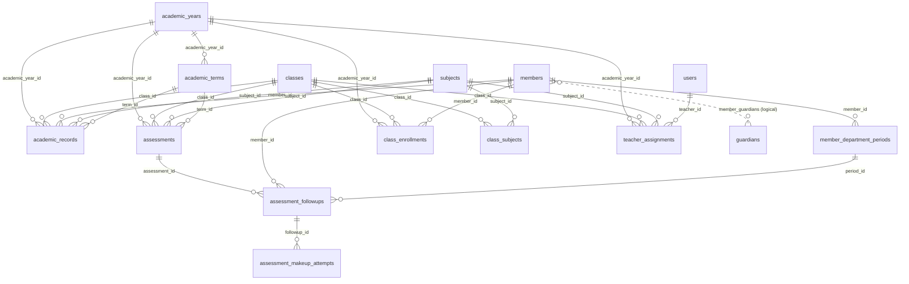
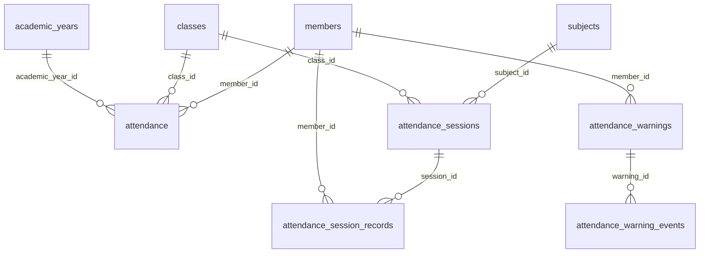

# Data dictionary (table level)

**Status:** generated 2026-10-23 from `main` at `46fbaa7` by scanning every schema source (`sql/legacy/database_schema.sql`, the legacy PHP migration scripts (now in `sql/legacy/php-migrations/`), `sql/*.sql`) for `CREATE TABLE` statements and declared foreign keys, and by counting references in application code. **Not compared with the production database**; the applied production state is unverified (see [DATABASE.md §4](DATABASE.md#4-applied-state-in-production-unverified)).

**Scope:** one row per table, grouped by domain. Column-level detail lives in the defining migration and in later `ALTER TABLE` migrations; this page tells you where to look. Purpose lines are one-sentence summaries taken from the defining migration and the code that uses each table.

## 1. Summary

- **113 table definitions** found in source; older documents say "about 100" for the live schema. The difference is explained by legacy and retired tables (for example finance/materials from a legacy PHP migration). Which of these exist in production is unverified.
- **68 declared foreign keys.** Many relations are enforced in code only; for example the Family Link tables declare none.
- **5 tables are not referenced** by application code (candidates for review, not for deletion).
- **Defined in:** the first file, in migration order, that creates the table. `sql/legacy/database_schema.sql` and `sql/legacy/php-migrations/admin/*.php` are legacy sources; versioned `sql/NNN_*.sql` migrations are the current mechanism ([ADR-0004](adr/0004-manual-idempotent-sql-migrations.md)).
- **Code refs:** number of application files (PHP/JS outside `sql/`, `docs/`, `tests/` and migrations) that mention the table name.

## 2. Core entity relationships

Solid lines are declared foreign keys. The dotted guardian link is logical only (composite primary key, no foreign key).

### 2.1 Academic structure, enrollment and grades

### 2.2 Attendance and alerting

`teacher_assignments.teacher_id` references `users` in the versioned migration `sql/003_production_hardening.sql`. The legacy PHP migration `sql/legacy/php-migrations/admin/002_add_academic_attendance_workflow.php` declared it against `members`. The diagram follows the versioned migration; the constraint actually present in production is unverified.

## 3. Tables by domain

### Identity, access and audit

| Table | Purpose | Defined in | Code refs |
|---|---|---|---|
| `activity_logs` | Application activity log. | `sql/001_production_patch.sql` | 24 |
| `api_refresh_legacy_exchanges` | Records of one-time exchanges of legacy long-lived app tokens. | `sql/010_refresh_token_rotation.sql` | 1 |
| `api_refresh_sessions` | Rotating refresh-token sessions (token families, revocation). | `sql/010_refresh_token_rotation.sql` | 2 |
| `security_rate_limits` | Counters for login and API rate limiting. | `sql/008_security_rate_limits.sql` | 2 |
| `users` | Staff and app accounts: username, password hash, role, `authorization_version`, profile fields. | `sql/legacy/database_schema.sql` | 92 · legacy definition |
| `wbws_audit_log` | Audit trail of sensitive changes. | `sql/013_application_schema_completion.sql` | 1 |

### Members and registration

| Table | Purpose | Defined in | Code refs |
|---|---|---|---|
| `departments` | Departments. | `sql/legacy/database_schema.sql` | 38 · legacy definition |
| `member_changes` | Change requests or history for member records. | `sql/legacy/php-migrations/admin/002_add_academic_attendance_workflow.php` | 2 · legacy definition |
| `member_code_migrations` | History of member-code format changes. | `sql/legacy/database_schema.sql` | 4 · legacy definition |
| `member_code_sequences` | Member-code counters. | `sql/legacy/database_schema.sql` | **Not referenced** by application code |
| `member_department_periods` | Periods a member is active in a department (Education / Mezmur); drives department status. | `sql/071_department_status_and_policy.sql` | 3 |
| `member_staff_positions` | Members holding staff positions. | `sql/legacy/database_schema.sql` | 3 · legacy definition |
| `member_type_settings` | Settings per member type. | `sql/legacy/database_schema.sql` | 1 · legacy definition |
| `members` | Member register (the central entity): identity, contact, section/age group, status, member code. | `sql/legacy/database_schema.sql` | 113 · legacy definition |
| `staff_positions` | Staff positions per department. | `sql/legacy/database_schema.sql` | 4 · legacy definition |

### Family Link (guardians)

| Table | Purpose | Defined in | Code refs |
|---|---|---|---|
| `guardian_aliases` | Alternative names and phones that identify the same guardian. | `sql/069_guardian_linkage.sql` | 4 |
| `guardian_link_suggestions` | Steward review queue of suggested guardian links. | `sql/069_guardian_linkage.sql` | 3 |
| `guardians` | Guardian (parent) entities. | `sql/069_guardian_linkage.sql` | 11 |
| `member_guardians` | Member-to-guardian links (composite key `member_id`, `guardian_id`). | `sql/069_guardian_linkage.sql` | 5 |

### Academic structure

| Table | Purpose | Defined in | Code refs |
|---|---|---|---|
| `academic_terms` | Terms (semesters) within a year. | `sql/013_application_schema_completion.sql` | 11 |
| `academic_years` | Academic years; one active year at a time. | `sql/012_runtime_schema_baseline.sql` | 21 |
| `class_enrollments` | Member enrollment in a class for a year. | `sql/013_application_schema_completion.sql` | 29 |
| `class_subjects` | Subjects taught in each class. | `sql/006_assignment_hardening.sql` | 14 |
| `classes` | Classes (grades) per section. | `sql/012_runtime_schema_baseline.sql` | 99 |
| `dept_settings` | Department-level settings. | `sql/013_application_schema_completion.sql` | 2 |
| `subjects` | Subjects. | `sql/legacy/php-migrations/admin/002_add_academic_attendance_workflow.php` | 40 · legacy definition |
| `teacher_assignments` | Teacher-to-class (and optional subject) assignments per year; the basis of teacher scoping. | `sql/006_assignment_hardening.sql` | 31 |

### Timetable and school calendar

| Table | Purpose | Defined in | Code refs |
|---|---|---|---|
| `school_day_offs` | Day-off rules. | `sql/078_school_calendar.sql` | 1 |
| `school_holidays` | School holidays (written by Education only). | `sql/078_school_calendar.sql` | 1 |
| `timetable_class_days` | Working days per class (class-day rule). | `sql/077_timetable_builder.sql` | 2 |
| `timetable_entries` | Recurring weekly timetable entries. | `sql/007_timetable.sql` | 3 |
| `timetable_makeup_classes` | Dated make-up classes. | `sql/077_timetable_builder.sql` | 2 |
| `timetable_periods` | Period (time-slot) definitions. | `sql/007_timetable.sql` | 1 |

### Assessments and grades

| Table | Purpose | Defined in | Code refs |
|---|---|---|---|
| `academic_records` | Scores per member and assessment context. | `sql/013_application_schema_completion.sql` | 14 |
| `assessment_followups` | Follow-ups for missed or failed assessments. | `sql/075_assessment_followups.sql` | 8 |
| `assessment_makeup_attempts` | Make-up attempts recorded against a follow-up (original record unchanged). | `sql/075_assessment_followups.sql` | 1 |
| `assessment_types` | Assessment types. | `sql/050_assessment_types.sql` | 1 |
| `assessments` | Assessments per class, subject and term, with a maximum score. | `sql/legacy/php-migrations/admin/003_add_assessments.php` | 20 · legacy definition |
| `grade_submissions` | Teacher grade submissions and review state. | `sql/013_application_schema_completion.sql` | 19 |

### Attendance (Education)

| Table | Purpose | Defined in | Code refs |
|---|---|---|---|
| `attendance` | Day-level attendance per member and class. | `sql/013_application_schema_completion.sql` | 108 |
| `attendance_month_rollup` | Monthly attendance roll-ups per member. | `sql/074_attendance_month_rollup.sql` | 6 |
| `attendance_policies` | Attendance alerting thresholds and policy. | `sql/071_department_status_and_policy.sql` | 2 |
| `attendance_rollup` | Pre-computed attendance roll-ups. | `sql/027_attendance_rollup.sql` | 2 |
| `attendance_session_records` | Per-member marks within a lesson session. | `sql/076_attendance_sessions.sql` | 1 |
| `attendance_sessions` | Lesson-level attendance sessions (class, subject, period). | `sql/076_attendance_sessions.sql` | 2 |
| `attendance_submission_events` | Submission and review events of attendance sheets. | `sql/073_attendance_submission_events.sql` | 2 |
| `attendance_summary` | Pre-computed attendance aggregates per member and year. | `sql/013_application_schema_completion.sql` | 4 |
| `attendance_warning_events` | History of each warning (raised, escalated, closed). | `sql/072_attendance_warnings.sql` | 1 |
| `attendance_warnings` | Attendance warnings per member (alerting). | `sql/072_attendance_warnings.sql` | 14 |

### Mezmur (choir) department

| Table | Purpose | Defined in | Code refs |
|---|---|---|---|
| `mezmur_attendance` | Mezmur attendance marks. | `sql/022_mezmur_attendance.sql` | 12 |
| `mezmur_attendance_audit` | Audit of Mezmur attendance changes. | `sql/022_mezmur_attendance.sql` | 5 |
| `mezmur_categories` | Hymn categories (hierarchical). | `sql/025_mezmur_hymn_offline.sql` | 4 |
| `mezmur_days` | Mezmur attendance days with program labels. | `sql/023_mezmur_date_attendance.sql` | 4 |
| `mezmur_hymn_categories` | Hymn-to-category links. | `sql/030_mezmur_taxonomy.sql` | 2 |
| `mezmur_hymn_words` | Hymn lyrics (words), including synced lyrics. | `sql/032_mezmur_hymn_words.sql` | 3 |
| `mezmur_hymn_zemarians` | Hymn-to-singer links. | `sql/030_mezmur_taxonomy.sql` | 2 |
| `mezmur_hymns` | Hymn library. | `sql/021_mezmur_department.sql` | 7 |
| `mezmur_play_stats` | Hymn play statistics. | `sql/038_mezmur_audio_media.sql` | 1 |
| `mezmur_sessions` | Mezmur attendance sessions. | `sql/022_mezmur_attendance.sql` | 4 |
| `mezmur_submissions` | Mezmur sheet submissions and review. | `sql/024_mezmur_submissions.sql` | 9 |
| `mezmur_user_favorites` | Users' favourite hymns. | `sql/038_mezmur_audio_media.sql` | 1 |
| `mezmur_zemarians` | Singers. | `sql/030_mezmur_taxonomy.sql` | 2 |
| `migration_055_mezmur_link_quarantine` | Quarantine copy of orphan links removed by migration 055 (kept as evidence). | `sql/055_mezmur_orphan_link_cleanup.sql` | **Not referenced** by application code |

### HR attendance (retired, archive only)

| Table | Purpose | Defined in | Code refs |
|---|---|---|---|
| `hr_attendance` | Former HR attendance marks. Retired 2026-10-07/18; kept untouched, nothing reads it. | `sql/026_hr_attendance.sql` | 2 |
| `hr_attendance_audit` | Audit of former HR attendance. Archive. | `sql/026_hr_attendance.sql` | 2 |
| `hr_submissions` | Former HR sheet submissions. Archive. | `sql/026_hr_attendance.sql` | 1 |

### Communication

| Table | Purpose | Defined in | Code refs |
|---|---|---|---|
| `announcements` | Announcements to audiences. | `sql/042_notification_center.sql` | 6 |
| `department_tasks` | Department tasks (legacy workflow module). | `sql/legacy/php-migrations/admin/002_add_academic_attendance_workflow.php` | 3 · legacy definition |
| `message_thread_participants` | Thread participants. | `sql/042_notification_center.sql` | 1 |
| `message_threads` | Direct-message threads. | `sql/042_notification_center.sql` | 1 |
| `messages` | Messages in threads. | `sql/042_notification_center.sql` | 34 |
| `notification_reads` | Read state of notifications and announcements. | `sql/042_notification_center.sql` | 2 |
| `notifications` | Per-user alerts. | `sql/012_runtime_schema_baseline.sql` | 21 |
| `shared_documents` | Shared documents (legacy workflow module). | `sql/legacy/php-migrations/admin/002_add_academic_attendance_workflow.php` | **Not referenced** by application code |

### Reporting

| Table | Purpose | Defined in | Code refs |
|---|---|---|---|
| `report_definitions` | Saved report definitions (Reporting Centre). | `sql/070_report_definitions.sql` | 1 |

### Mobile app, sync and telemetry

| Table | Purpose | Defined in | Code refs |
|---|---|---|---|
| `api_idempotency` | Idempotency reservations for API writes. | `sql/009_api_idempotency.sql` | 1 |
| `api_idempotency_records` | Stored responses for idempotent replay. | `sql/009_api_idempotency.sql` | 1 |
| `api_sync_attempts` | Sync attempt monitoring from the app outbox. | `sql/059_api_sync_attempts.sql` | 7 |
| `app_crash_signatures` | Grouped crash signatures. | `sql/063_crash_signatures.sql` | 3 |
| `app_downloads` | APK download records. | `sql/051_app_telemetry.sql` | 3 |
| `app_installations` | Anonymous app installations. | `sql/051_app_telemetry.sql` | 4 |
| `app_telemetry_events` | App telemetry events. | `sql/051_app_telemetry.sql` | 7 |
| `sync_changes` | Change feed (monotonic `revision`) for incremental sync. | `sql/057_sync_change_feed.sql` | 2 |
| `sync_feed_state` | Retention floor and head state of the change feed. | `sql/057_sync_change_feed.sql` | 1 |

### Monitoring and failure intelligence

| Table | Purpose | Defined in | Code refs |
|---|---|---|---|
| `arkeon_error_log` | Error log (monitor). | `sql/011_monitor_schema.sql` | 7 |
| `arkeon_uptime_log` | Uptime checks (monitor). | `sql/011_monitor_schema.sql` | 4 |
| `failure_alerts` | Alerts raised from failure issues. | `sql/065_failure_alerts.sql` | 2 |
| `failure_issues` | Grouped failure issues. | `sql/064_failure_intelligence.sql` | 5 |
| `failure_remediation_catalog` | Known remediation steps. | `sql/064_failure_intelligence.sql` | 4 |
| `failure_reports` | Raw failure reports. | `sql/064_failure_intelligence.sql` | 3 |

### Platform settings and AI

| Table | Purpose | Defined in | Code refs |
|---|---|---|---|
| `ai_chat_history` | AI assistant chat history. | `sql/013_application_schema_completion.sql` | 1 |
| `ai_provider_configs` | AI provider configuration. | `sql/013_application_schema_completion.sql` | 1 |
| `cache_storage` | Generic cache table. | `sql/legacy/database_schema.sql` | **Not referenced** by application code |
| `system_branding` | Branding (name, logos, colours). | `sql/012_runtime_schema_baseline.sql` | 5 |
| `system_settings` | Key-value system settings, including feature flags. | `sql/013_application_schema_completion.sql` | 3 |

### Public website (CMS)

| Table | Purpose | Defined in | Code refs |
|---|---|---|---|
| `cms_gallery_categories` | Gallery categories. | `sql/002_cms_schema.sql` | 3 |
| `cms_gallery_photos` | Gallery photos. | `sql/002_cms_schema.sql` | 3 |
| `cms_programs` | Programs shown on the public site. | `sql/002_cms_schema.sql` | 2 |
| `cms_registration_submissions` | Public registration-form submissions (reviewed before becoming members). | `sql/002_cms_schema.sql` | 2 |
| `cms_schedule` | Public schedule. | `sql/002_cms_schema.sql` | 2 |
| `cms_social_links` | Social links. | `sql/002_cms_schema.sql` | 2 |
| `cms_teachers` | Teachers shown on the public site. | `sql/002_cms_schema.sql` | 2 |

### Finance and materials (legacy module)

| Table | Purpose | Defined in | Code refs |
|---|---|---|---|
| `finance_budgets` | Budgets. | `sql/legacy/php-migrations/admin/004_add_finance_material_tables.php` | **Not referenced** by application code |
| `finance_categories` | Finance categories. | `sql/legacy/php-migrations/admin/004_add_finance_material_tables.php` | 1 · legacy definition |
| `finance_member_fees` | Member fees. | `sql/legacy/php-migrations/admin/004_add_finance_material_tables.php` | 1 · legacy definition |
| `finance_transactions` | Finance transactions. | `sql/legacy/php-migrations/admin/004_add_finance_material_tables.php` | 4 · legacy definition |
| `material_categories` | Material categories. | `sql/legacy/php-migrations/admin/004_add_finance_material_tables.php` | 1 · legacy definition |
| `material_items` | Material items. | `sql/legacy/php-migrations/admin/004_add_finance_material_tables.php` | 3 · legacy definition |
| `material_requests` | Material requests. | `sql/legacy/php-migrations/admin/004_add_finance_material_tables.php` | 3 · legacy definition |
| `material_transactions` | Material stock movements. | `sql/legacy/php-migrations/admin/004_add_finance_material_tables.php` | 1 · legacy definition |

### Groups

| Table | Purpose | Defined in | Code refs |
|---|---|---|---|
| `wbws_group_leaders` | Group leaders. | `sql/legacy/database_schema.sql` | 4 · legacy definition |
| `wbws_group_members` | Group membership. | `sql/013_application_schema_completion.sql` | 4 |
| `wbws_groups` | Member groups. | `sql/legacy/database_schema.sql` | 5 · legacy definition |

## 4. Declared foreign keys

All declared foreign keys (child column → parent)

| Child table | Column | Parent |
|---|---|---|
| `academic_records` | `academic_year_id` | `academic_years.id` |
| `academic_records` | `class_id` | `classes.id` |
| `academic_records` | `member_id` | `members.id` |
| `academic_records` | `subject_id` | `subjects.id` |
| `academic_records` | `term_id` | `academic_terms.id` |
| `academic_terms` | `academic_year_id` | `academic_years.id` |
| `assessment_followups` | `assessment_id` | `assessments.id` |
| `assessment_followups` | `member_id` | `members.id` |
| `assessment_followups` | `period_id` | `member_department_periods.id` |
| `assessment_makeup_attempts` | `followup_id` | `assessment_followups.id` |
| `assessments` | `academic_year_id` | `academic_years.id` |
| `assessments` | `class_id` | `classes.id` |
| `assessments` | `subject_id` | `subjects.id` |
| `assessments` | `term_id` | `academic_terms.id` |
| `attendance` | `academic_year_id` | `academic_years.id` |
| `attendance` | `class_id` | `classes.id` |
| `attendance` | `member_id` | `members.id` |
| `attendance_month_rollup` | `member_id` | `members.id` |
| `attendance_session_records` | `member_id` | `members.id` |
| `attendance_session_records` | `session_id` | `attendance_sessions.id` |
| `attendance_sessions` | `class_id` | `classes.id` |
| `attendance_sessions` | `subject_id` | `subjects.id` |
| `attendance_summary` | `academic_year_id` | `academic_years.id` |
| `attendance_summary` | `member_id` | `members.id` |
| `attendance_warning_events` | `warning_id` | `attendance_warnings.id` |
| `attendance_warnings` | `member_id` | `members.id` |
| `class_enrollments` | `academic_year_id` | `academic_years.id` |
| `class_enrollments` | `class_id` | `classes.id` |
| `class_enrollments` | `member_id` | `members.id` |
| `class_subjects` | `class_id` | `classes.id` |
| `class_subjects` | `subject_id` | `subjects.id` |
| `cms_gallery_photos` | `category_id` | `cms_gallery_categories.id` |
| `department_tasks` | `related_member_id` | `members.id` |
| `finance_member_fees` | `member_id` | `members.id` |
| `finance_transactions` | `member_id` | `members.id` |
| `hr_attendance` | `marked_by` | `users.id` |
| `hr_attendance` | `member_id` | `members.id` |
| `hr_submissions` | `reviewed_by` | `users.id` |
| `hr_submissions` | `taker_id` | `users.id` |
| `material_items` | `category_id` | `material_categories.id` |
| `material_transactions` | `item_id` | `material_items.id` |
| `member_changes` | `member_id` | `members.id` |
| `member_department_periods` | `member_id` | `members.id` |
| `member_staff_positions` | `member_id` | `members.id` |
| `member_staff_positions` | `position_id` | `staff_positions.id` |
| `mezmur_attendance` | `marked_by` | `users.id` |
| `mezmur_attendance` | `member_id` | `members.id` |
| `mezmur_attendance` | `session_id` | `mezmur_sessions.id` |
| `mezmur_categories` | `parent_id` | `mezmur_categories.id` |
| `mezmur_days` | `created_by` | `users.id` |
| `mezmur_hymn_categories` | `category_id` | `mezmur_categories.id` |
| `mezmur_hymn_categories` | `hymn_id` | `mezmur_hymns.id` |
| `mezmur_hymn_zemarians` | `hymn_id` | `mezmur_hymns.id` |
| `mezmur_hymn_zemarians` | `zemarian_id` | `mezmur_zemarians.id` |
| `mezmur_hymns` | `created_by` | `users.id` |
| `mezmur_hymns` | `updated_by` | `users.id` |
| `mezmur_play_stats` | `hymn_id` | `mezmur_hymns.id` |
| `mezmur_sessions` | `created_by` | `users.id` |
| `mezmur_submissions` | `reviewed_by` | `users.id` |
| `mezmur_submissions` | `taker_id` | `users.id` |
| `mezmur_user_favorites` | `hymn_id` | `mezmur_hymns.id` |
| `staff_positions` | `department_id` | `departments.id` |
| `teacher_assignments` | `academic_year_id` | `academic_years.id` |
| `teacher_assignments` | `class_id` | `classes.id` |
| `teacher_assignments` | `subject_id` | `subjects.id` |
| `teacher_assignments` | `teacher_id` | `members.id` |
| `teacher_assignments` | `teacher_id` | `users.id` |
| `wbws_group_leaders` | `group_id` | `wbws_groups.id` |

## 5. Known gaps

- No column-level dictionary yet. Recommended: generate one from a schema-only export of a provisioned test database (never from production data), and keep it under version control.
- Legacy schema sources (`sql/legacy/database_schema.sql`, `sql/legacy/php-migrations/admin/*.php`) overlap with versioned migrations; see [DATABASE.md §2](DATABASE.md#2-sources-of-schema-truth-and-their-limits).
- Tables not referenced by code should be reviewed by the maintainers before any change; nothing here recommends deleting data.
