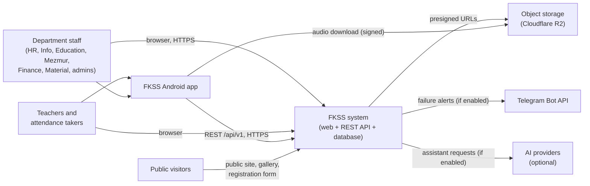
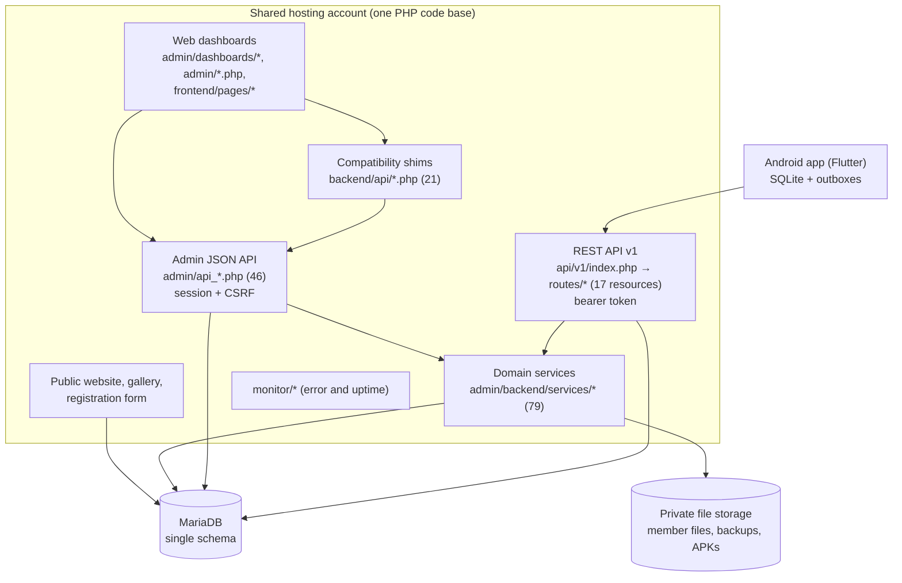
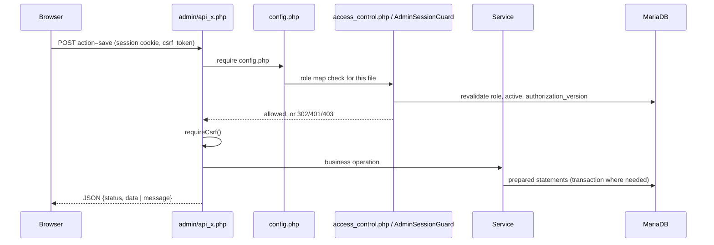
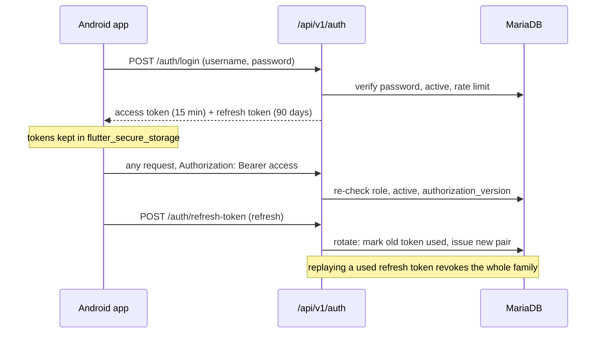
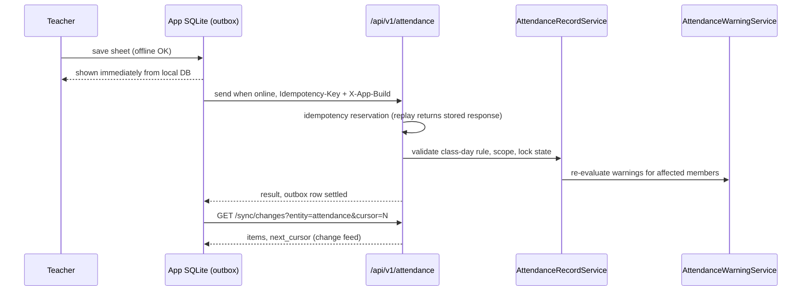
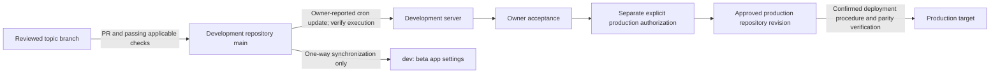

# FKSS — Technical Design Document (software architecture)

| Field | Value |
|---|---|
| Document | Technical Requirements / Software Architecture Document (TRD/SAD), arc42-style |
| Status | **Baseline. Draft for review by the engineering team** |
| Version | 1.0 (2026-10-22) |
| Describes | `main` at `46fbaa7`, read from source. Runtime behaviour in production was not re-tested for this document |
| Detailed references | [ARCHITECTURE.md](../ARCHITECTURE.md) (component detail) · [API.md](../API.md) · [DATABASE.md](../DATABASE.md) · [SECURITY.md](../SECURITY.md) · [OPERATIONS.md](../OPERATIONS.md) · [ROLES_AND_PERMISSIONS.md](../ROLES_AND_PERMISSIONS.md) |
| Requirements | [PRD](../product/PRD.md) · Decisions: [ADR index](../adr/README.md) |

Diagrams use Mermaid. **2026-10-28 review:** the original `46fbaa7` design remains a source-bounded baseline; the hosting, release, local-lock and quality-evidence clarifications below were checked against `7e28157` and current owner instructions. Diagrams simplify flows and do not prove every failure/compatibility path. “Implemented” means a source mechanism exists, not production, complete permission or device acceptance. [ADR-0021](../adr/0021-development-acceptance-before-production.md) supersedes historical automatic production-equivalence/no-cron assumptions.

---

## 1. Introduction and goals

FKSS is a school management system for one Sunday school: web dashboards for each department, plus an offline-first Android app for teachers and staff. The requirements are in the [PRD](../product/PRD.md).

**Top quality goals (in priority order)**

| # | Quality goal | Why |
|---|---|---|
| 1 | **Data integrity** of the member register, marks and attendance | These records drive report cards, promotion and pastoral follow-up |
| 2 | **Least-privilege access to personal data** | The register holds children's and families' data |
| 3 | **Works offline and on poor networks** | Teachers record attendance on low-end phones on 2G/3G |
| 4 | **Operable by a very small team on shared hosting** | Budget and skills constraint |
| 5 | **Changeability** | The product has grown weekly; this is currently the weakest goal (section 11) |

## 2. Constraints

| Type | Constraint | Consequence |
|---|---|---|
| Hosting | Historical shared-hosting record: LiteSpeed, PHP 8.5 and MariaDB; current capabilities not reverified | PHP monolith and committed `vendor/`; server CLI jobs require operator scheduling. Mobile durable queues and Android scheduling exist. A blanket “no cron/queues” assertion is incorrect |
| Database changes | Maintainer-reviewed manual SQL application; target applied state unknown | Additive/idempotent design, preflight gates and no migration ledger ([ADR-0004](../adr/0004-manual-idempotent-sql-migrations.md)) |
| Deployment | Development-main integration → independently observed cron update → owner acceptance → separate production authorization | Historical SFTP procedure is conditional, not automatic promotion ([OPERATIONS.md](../OPERATIONS.md)) |
| Mobile distribution | First-party APK publication and in-app updater | Signing continuity, phone acceptance and publication are separate owner gates ([release guide](../../Mobile/wbws_flutter_app/docs/RELEASE.md)) |
| Locale | Ethiopian-calendar business-display policy and Amharic content | Gregorian/ISO storage and some technical diagnostics exist; policy is not proof every displayed date/export has been audited ([ADR-0008](../adr/0008-ethiopian-calendar-only.md)) |
| Organisation | Maintainer approval for every schema change, deploy and production action | Changes are planned, reviewed and deployed in explicit steps |

## 3. Context (C4 level 1)

A CDN/WAF proxy sits in front of the origin. There is no e-mail, SMS or payment integration.

## 4. Solution strategy

| Problem | Approach |
|---|---|
| Many departments on one register | One database and one PHP code base; per-department dashboards; a central page and endpoint role map (`admin/access_control.php`) |
| Mobile on poor networks | Offline-first Flutter app: SQLite cache, outboxes, idempotent writes, change feed ([ADR-0003](../adr/0003-offline-first-mobile.md)) |
| Mobile sessions with revocable authorization | Short-lived signed access tokens, server-stored rotating refresh sessions and database scope revalidation; legacy compatibility settings qualify immediate enforcement ([API authentication](../API.md#2-authentication)) |
| Shared business rules between web and API | Service classes in `admin/backend/services/` (79 files), called from both. Consolidation is incomplete (section 11) |
| Request work and scheduled maintenance | Attendance writes trigger warning evaluation; CLI-only cleanup, retention/reconciliation and alert jobs require separately verified scheduling. Android has its own background-sync mechanism |
| Capability and schema rollout | `FeatureGate` enforces actual boolean capability constants. `SchoolCalendarService` probes database tables, not the mere presence of `sql/078_school_calendar.sql` in Git. Feature, permission and schema readiness are separate gates |

## 5. Building blocks

### 5.1 Containers (C4 level 2)

| Container | Technology | Responsibility | Detail |
|---|---|---|---|
| Web dashboards | PHP-rendered HTML, vanilla JS, CSS | One workspace per role | [ARCHITECTURE.md §2](../ARCHITECTURE.md#2-php-web-application-admin) |
| Admin JSON API | PHP, mysqli | Web business operations; `?action=` dispatch | [API.md](../API.md) |
| Compatibility shims | PHP | Older front-end entry points; 20 delegate to the admin API, `init.php` returns dashboard bootstrap data | [ARCHITECTURE.md §3](../ARCHITECTURE.md#3-the-three-api-layers-unfinished-consolidation) |
| REST API v1 | PHP router, JSON envelope | Mobile app contract | [API.md §2–4](../API.md#2-authentication) |
| Domain services | PHP classes, namespace `App\Services` | Business rules shared by web and REST | [ARCHITECTURE.md §2](../ARCHITECTURE.md#2-php-web-application-admin) |
| Database | MariaDB (InnoDB, utf8mb4) | All state | [DATABASE.md](../DATABASE.md) |
| Android app | Flutter, sqflite, provider | Offline-first client for 12 roles | [ARCHITECTURE.md §4](../ARCHITECTURE.md#4-mobile-application-mobilewbws_flutter_app) |

### 5.2 Key components (C4 level 3, PHP)

| Concern | Component(s) |
|---|---|
| Bootstrap and configuration | `config.php` (secrets file, DB, session, CSRF helpers, security headers), `school_config.php`, `FeatureGate` |
| Access control | `admin/access_control.php` (web), `AdminSessionGuard` (session revalidation), `api/v1/core/{auth,acl}.php` (REST) |
| Members | `MemberRegistrationPolicy`, `MemberDuplicateService`, `MemberCategory`, `IdentityCodeService`, `MemberFileService`, `GuardianMatchService` |
| Education | `SubjectDurationPolicy`, `AssessmentTypeService`, `SubmissionService`, `ReviewTransitionPolicy`, `ReportCardService`, `TimetableService`, `SchoolCalendarService`, `AcademicTrackingService` |
| Attendance | `AttendanceRecordService`, `AttendanceSummaryService`, `AttendanceRiskService`, `AttendanceWarningService`, `AttendancePolicyService`, `AttendanceMonthRollupService`, `LessonAttendanceService` |
| Mezmur | `Mezmur*Service`, `MezmurMediaService`, `MezmurSchemaReconciler` (runtime DDL) |
| Reporting | `admin/backend/reporting/ReportRegistry.php` and the governed query and export services |
| Mobile platform | `RefreshTokenService`, `ApiIdempotencyService`, `SyncChangeFeedService`, `AppReleaseManager`, `AppTelemetryService`, `Failure*Service` |
| Cross-cutting | `SecurityRateLimiter`, `SecurityAuditService`, `NotificationCenterService`, `BackupService`, `admin/backend/danger_confirm.php` |

## 6. Runtime views

### 6.1 Web request (staff dashboard)

### 6.2 Mobile login and token refresh

### 6.3 Offline attendance capture and sync

### 6.4 App update

The app polls `GET /api/v1/app/config`, compares its build number with the configured latest and minimum builds, and offers an optional update or requires a forced one. It then downloads the APK from `GET /api/v1/app/download`. The Super Admin uploads APKs through the release manager.

## 7. Deployment view

| Environment | Source | Evidence boundary |
|---|---|---|
| Development | Development repository `main` | Merge and server cron/deployment/acceptance are independently recorded events |
| Production | Separately approved production repository revision | Do not infer current deployment from a dated record; confirm files, schema and configuration under authorization |
| Beta | `dev`, with beta-only app settings | No reverse merge; actual server update mechanism remains unverified |
| CI | Candidate SHA / GitHub Actions | PHP 8.4 behavior tests, PHP 8.5 lint, MariaDB 11.4, Python 3.11, Node 22, Flutter 3.44.9 and JDK 17; [exact workflow guide](../DEVELOPMENT_AND_TESTING.md) |

## 8. Cross-cutting concepts

| Concept | Design |
|---|---|
| Authentication | Web: PHP session, 30-minute idle timeout, rate-limited login. Mobile: custom HMAC-SHA256 two-part access token plus rotating refresh tokens |
| Authorization | Role map per file name; in-endpoint checks for department ownership and class assignment; REST role helpers (`acl.php`); `authorization_version` invalidates stale sessions and tokens |
| Input and output safety | Prepared statements; HTML escaping helpers (`e()`, `esc()`); hex-escaped JSON in script contexts; CSRF on web writes |
| Personal data | Role-scoped fields (`apiRolesPii()`, reporting field permissions); private file storage; audited exports |
| Auditing | `activity_logs`, `SecurityAuditService`, domain audit tables (attendance, Mezmur, finance ledger, exports) |
| Idempotency and concurrency | `Idempotency-Key` reservations completed inside the business transaction; locking reads for duplicate checks; one packet per slot |
| Error handling | Errors logged, not displayed; REST returns a stable JSON envelope and typed error codes (for example `AUTH_SCOPE_CHANGED`) |
| Localisation | Ethiopian-calendar conversion at the edges; Amharic labels from single sources (`MemberCategory`) |
| Feature flags | `FEATURE_*` constants, defaults in `school_config.php`, enforced by `FeatureGate` on pages, API resources and mobile tiles |
| Observability | Error monitor, uptime script (needs cron), mobile telemetry, crash signatures, failure issues and alerts (Telegram optional) |
| Destructive actions | Tiered confirmation; server-side phrase check for high-risk actions ([ADR-0013](../adr/0013-tiered-danger-confirmation.md)) |

## 9. Architecture decisions

See the [decision record index](../adr/README.md).

## 10. Quality requirements

| Quality | Scenario | Current state |
|---|---|---|
| Integrity | Repeated submission with a stable idempotency key should not duplicate an accepted write | Source mechanism plus lifecycle tests; not a guarantee for every route, client identity or failure path |
| Security | Disabled or changed staff authorization should invalidate access | Session/token revalidation exists; legacy API scope behavior depends on client build and `API_AUTHZ_LEGACY_COMPAT_UNTIL`, so immediate revocation is not a universal claim |
| Security | Teachers should not access another class's marks | Scope checks/tests cover specific paths; this is not a complete action-level authorization audit |
| Offline | Attendance captured locally should survive and reconcile when eligible | Durable outbox/recovery mechanisms exist; network, owner/scope, schema and server acceptance remain dependencies. Destructive discard/uninstall can remove unsent work |
| Performance | Member lists for 5,000+ students stay responsive | Design target: capped page sizes and indexes. **No load test on record** |
| Recoverability | Restore production after data loss | **Not met:** restore never tested; backups in the same account |
| Changeability | A new engineer changes a grading rule in one place | **Partly met:** rules are duplicated across API layers |

## 11. Risks and technical debt

The full list, with evidence and recommended actions, is in [OPERATIONS.md §7](../OPERATIONS.md#7-known-limitations-and-open-questions). Architecture-level items:

1. **Three API layers with duplicated rules.** Decide the canonical layer per domain, then consolidate behind services.
2. **Large components.** Dashboards and local storage combine many responsibilities. Historical line counts are not current inventories; any split needs a separately reviewed behavioral change.
3. **Schema management.** No migration ledger, a stale `sql/legacy/database_schema.sql`, and runtime DDL. Introduce a ledger and a verified baseline through a separate approved change.
4. **Runtime parity.** PHP 8.4 behavior tests and PHP 8.5 lint do not prove behavior on the historical PHP 8.5 production environment; current runtime is unverified.
5. **Delivery evidence.** The former 79-skip CI gap was resolved at the [documented baseline](../reports/DOCUMENTATION_BASELINE_2026-10-28.md); each candidate still needs fresh checks. Actual signing certificates, host schedules, deployment parity and owner phone acceptance are separate unverified gates.
6. **Repository layout.** It mixes the web app, API, mobile app, tests and legacy folders at the root. A target structure should be agreed before any move, because paths are referenced by the server, the mobile app and the tests.

## 12. Glossary

See [GLOSSARY.md](../product/GLOSSARY.md).
